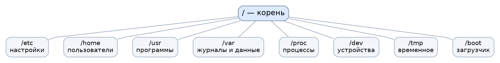

# Конспект: введение в GNU/Linux

Источник заданий: слайды 1–26 презентации «ОС L (1).pptx». Это самостоятельный конспект, а не дословная перепечатка слайдов.

## GNU, Linux и дистрибутив

GNU — проект свободного программного обеспечения, начатый Ричардом Столменом в 1983 году. Проект создаёт компоненты свободной Unix-подобной операционной системы: компилятор GCC, командную оболочку Bash, Coreutils и др. Свободное ПО предоставляет свободу запуска, изучения, изменения и распространения при соблюдении условий лицензии.

Linux — ядро ОС. Оно управляет процессами, памятью, устройствами, файловыми системами и системными вызовами. Работающая система включает не только ядро, но и пользовательские программы, библиотеки, утилиты и средства администрирования. Поэтому многие системы называют GNU/Linux; существуют и системы на ядре Linux без типичного набора GNU-компонентов.

**Дистрибутив Linux** — подготовленная к установке и использованию ОС со своим набором пакетов, репозиториями, программой установки, настройками и политикой обновлений. Примеры:

| Семейство / система | Особенности |
|---|---|
| Debian | Сообщество, стабильные выпуски, пакетный менеджер APT и формат DEB |
| Ubuntu | Основана на Debian, разрабатывается при участии Canonical; настольные и серверные редакции |
| Linux Mint | Ориентирована на настольную работу; версии на базе Ubuntu/Debian |
| Arch Linux | Rolling release, минимальная исходная установка, pacman, пользовательские пакеты AUR |
| Manjaro | Базируется на Arch; имеет собственный цикл тестирования пакетов |
| Fedora | Сообщество, новые версии технологий, связана с экосистемой Red Hat |
| RHEL | Коммерческая корпоративная ОС с поддержкой Red Hat |
| CentOS Stream | Ветка разработки, предшествующая очередным минорным выпускам RHEL; это **не** прежняя точная бесплатная пересборка RHEL |
| openSUSE | Tumbleweed — rolling release; Leap — стабильная ветка |

Изображения и статистика использования из презентации зависят от времени. Вместо фиксированных процентов стоит проверять актуальные данные на дату сдачи.

## Структура файловой системы

У Linux единое дерево каталогов с корнем `/`. Другие файловые системы подключаются к этому дереву с помощью монтирования. Файлы, ссылки, устройства и каталоги имеют права доступа и владельцев.



| Каталог | Значение |
|---|---|
| `/` | Корень дерева |
| `/bin`, `/sbin` | Базовые утилиты; во многих современных системах — ссылки на `/usr/bin`, `/usr/sbin` |
| `/etc` | Системные настройки |
| `/home` | Домашние каталоги пользователей |
| `/root` | Домашний каталог root |
| `/usr` | Пользовательские системные программы, библиотеки, общие ресурсы |
| `/var` | Изменяемые данные: журналы, кеши, очереди |
| `/tmp` | Временные файлы |
| `/dev` | Узлы устройств |
| `/proc` | Виртуальная файловая система сведений о ядре и процессах |
| `/sys` | Представление устройств и подсистем ядра |
| `/boot` | Файлы загрузки ОС |
| `/mnt`, `/media` | Точки для монтирования других носителей |
| `/opt` | Дополнительное ПО |

**Inode (индексный дескриптор)** хранит метаданные: тип, права, владельца, время, размеры и указатели на данные. Имя файла хранится в записи каталога и ссылается на inode. Жёсткие ссылки могут указывать на один inode. Символическая ссылка — отдельный файл с путём к другому объекту.

## Ключевые конфигурации

`/etc/hostname` — имя хоста; `/etc/os-release` — идентификатор и версия системы; `/etc/hosts` — локальные сопоставления имён с IP; `/etc/resolv.conf` — параметры DNS-резолвера (часто генерируются менеджером сети). `/etc/passwd` содержит учётные записи, `/etc/group` группы, `/etc/shadow` — защищённую информацию об аутентификации. `/etc/ssh/` — настройки SSH; `~/.ssh/config` — клиентские настройки конкретного пользователя. `/etc/fstab` — постоянные правила монтирования; `/etc/sudoers` и `/etc/sudoers.d/` — политика sudo (редактирование через `visudo`); `/etc/default/grub` — параметры генерации GRUB в некоторых дистрибутивах; `/etc/crontab` — системный crontab.

**Журналы:** `/var/log/` содержит файлы журналов, если они настроены; `journalctl` читает systemd-journal. На Debian часто есть `/var/log/auth.log` или используется journal. Для просмотра используются `less`, `tail -f`, `journalctl -xe` и `man`.

### Полезные команды

```bash
uname -a
cat /etc/os-release
pwd
ls -la /
ls -li /etc/hosts
stat /etc/hosts
man ls
journalctl -n 20 --no-pager  # если установлен systemd
```

## Заключение

GNU/Linux включает ядро, набор системных утилит, библиотеки и приложения. Основные навыки администратора: понимать назначение каталогов, читать конфигурации, проверять права, контролировать процессы и мониторинг системы.
